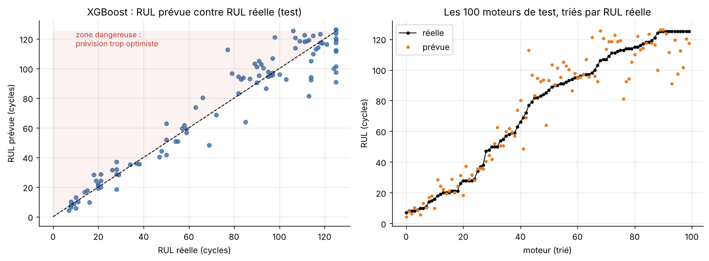
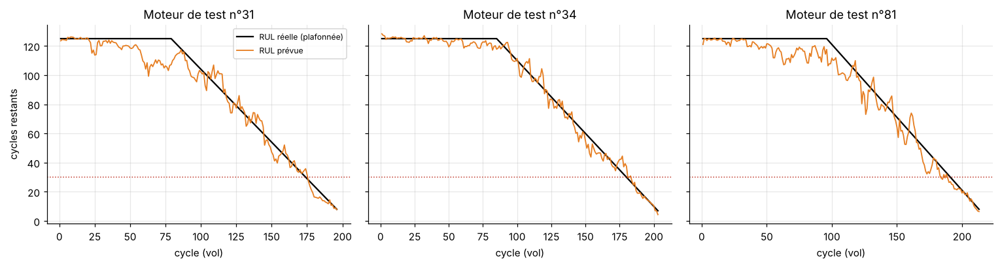
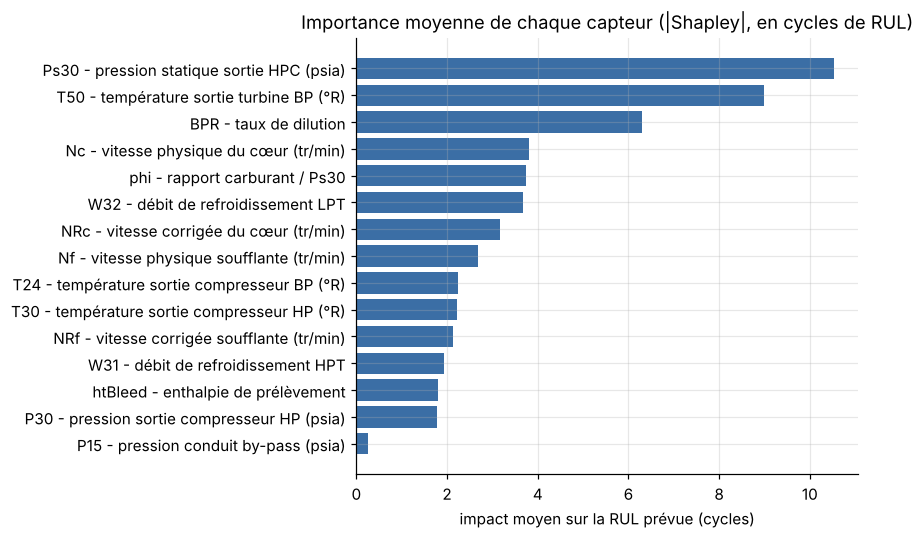

# Maintenance prédictive des moteurs d'avion : prévoir la panne avant qu'elle n'arrive

À partir des capteurs d'un turboréacteur, ce projet prévoit **combien de vols il reste avant la panne** (durée de vie restante, ou *RUL*) et décide **quand envoyer le moteur en inspection**, en tenant compte du fait qu'une panne ratée coûte bien plus cher qu'une inspection en trop.

Un accident d'avion résulte presque toujours d'une chaîne de causes, mais la défaillance d'un moteur en vol fait partie des événements que l'aéronautique veut éviter à tout prix. C'est pourquoi motoristes et compagnies (Safran, Rolls-Royce, Air France Industries) surveillent leurs moteurs en continu : c'est la **maintenance prédictive**.

👉 Tout est dans le notebook : [`notebooks/maintenance_predictive.ipynb`](notebooks/maintenance_predictive.ipynb)

## Résultats

*Jeu de test officiel de la NASA (FD001) : 100 moteurs jamais vus pendant l'entraînement.*

| Modèle | RMSE (cycles) | MAE (cycles) | R² | Score NASA ↓ |
|---|---|---|---|---|
| Ridge (linéaire) | 16,4 | 13,3 | 0,83 | 415 |
| Forêt aléatoire | 11,4 | 8,1 | 0,92 | 189 |
| **XGBoost** | **11,0** | **7,8** | **0,92** | **178** |

- **Erreur typique de 11 vols**, du niveau des articles de référence qui utilisent des réseaux de neurones profonds (RMSE entre 11 et 18 sur ce jeu).
- **Plus la panne approche, plus la prévision est précise** : erreur moyenne de 3,5 cycles pour les moteurs à moins de 30 vols de la panne.
- **Règle d'alerte** (inspection si RUL prévue ≤ 42 cycles, seuil choisi par minimisation du coût) : **25 pannes imminentes détectées sur 25**, avec seulement 5 fausses alertes sur 75 moteurs sains.
- **Même pipeline, autre scénario** (FD003, deux modes de panne possibles) : RMSE de 10,6 cycles sans aucun réglage supplémentaire.

<p align="center">
  
</p>

<p align="center">
  
  <br><em>La prévision recalculée après chaque vol, pour trois moteurs du test.</em>
</p>

## Démarche

1. **Données** : NASA C-MAPSS, simulateur de turboréacteur. 100 moteurs tournent jusqu'à la panne (entraînement) ; 100 autres sont coupés avant (test), avec la vraie durée de vie restante fournie par la NASA.
2. **Exploration** : 6 capteurs constants retirés ; la dégradation du compresseur haute pression apparaît dans les 50 à 100 derniers vols (température en sortie de turbine qui monte, pression Ps30 qui augmente).
3. **Cible plafonnée à 125 cycles** : un moteur sain ne montre aucun signe d'usure, on ne peut donc pas distinguer 300 cycles restants de 150 (Heimes, 2008).
4. **Variables sans fuite de données** : moyennes glissantes, écart-type, pente sur 20 cycles et dérive par rapport à l'état neuf du moteur, calculées uniquement avec le passé.
5. **Validation croisée par moteur** (`GroupKFold`) : un même moteur n'est jamais à la fois en entraînement et en validation.
6. **Évaluation** : RMSE, MAE et **score asymétrique de la NASA** (challenge PHM 2008), qui punit plus fort une prévision trop optimiste qu'une prévision trop prudente.
7. **Décision de maintenance** : une panne ratée coûte 50, une fausse alerte coûte 1. Le seuil d'alerte est choisi sur la validation croisée, puis vérifié sur le test. Comparaison d'une règle sur la RUL prévue et d'un classifieur direct (probabilité de panne dans les 30 vols).
8. **Explicabilité** : valeurs de Shapley calculées avec XGBoost, regroupées par capteur physique. Le modèle s'appuie sur les capteurs qu'affecte réellement une usure du compresseur.

<p align="center">
  
</p>

## Lancer le projet

```bash
git clone https://github.com/<ton-pseudo>/maintenance-predictive-moteurs-avion.git
cd maintenance-predictive-moteurs-avion
python -m venv .venv && source .venv/bin/activate   # Windows : .venv\Scripts\activate
pip install -r requirements.txt
jupyter notebook notebooks/maintenance_predictive.ipynb
```

Exécution complète : environ 3 minutes sur un ordinateur portable, sans GPU. Les données FD001 et FD003 sont incluses dans `data/`.

**Sur Google Colab** : dans une première cellule, lance
`!git clone https://github.com/<ton-pseudo>/maintenance-predictive-moteurs-avion.git && pip install -q xgboost`
puis `%cd maintenance-predictive-moteurs-avion/notebooks` et exécute le notebook.

## Structure

```
maintenance-predictive-moteurs-avion/
├── notebooks/maintenance_predictive.ipynb   # l'analyse complète, commentée
├── src/
│   ├── data.py          # chargement C-MAPSS, calcul de la RUL, nom des capteurs
│   ├── features.py      # variables glissantes causales (moyenne, pente, dérive)
│   ├── models.py        # Ridge, forêt aléatoire, XGBoost, validation par moteur
│   └── evaluation.py    # RMSE, score NASA, coût de maintenance, choix du seuil
├── scripts/build_notebook.py   # régénère le notebook
├── data/                # données NASA (FD001, FD003)
├── figures/             # graphiques générés par le notebook
└── resultats/           # tableaux de scores (CSV)
```

## Limites et pistes

- **Données simulées** : les vraies données moteur sont confidentielles. La méthode, elle, est celle utilisée en industrie.
- **Une seule cause** : ce projet anticipe la défaillance moteur, un maillon parmi d'autres (météo, facteur humain, conception) dans la sécurité aérienne.
- **Conditions de vol variables** (FD002, FD004) : normaliser chaque capteur par régime de vol avant de construire les variables.
- **Incertitude** : prévoir un intervalle (régression quantile) plutôt qu'un seul chiffre, pour une décision encore plus prudente.
- **Deep learning** : comparer à un LSTM ou un CNN 1D sur les séquences brutes.

## Compétences mobilisées

Séries temporelles multivariées · ingénierie de variables sans fuite de données · XGBoost, forêts aléatoires · validation croisée groupée · métriques asymétriques · décision sous coûts · explicabilité (Shapley)

## Références

- Saxena, A., Goebel, K., Simon, D., Eklund, N. (2008). *Damage Propagation Modeling for Aircraft Engine Run-to-Failure Simulation*. PHM 2008.
- Heimes, F. O. (2008). *Recurrent Neural Networks for Remaining Useful Life Estimation*. PHM 2008.
- Li, X., Ding, Q., Sun, J.-Q. (2018). *Remaining useful life estimation in prognostics using deep convolution neural networks*. Reliability Engineering & System Safety.
- Lundberg, S., Lee, S.-I. (2017). *A Unified Approach to Interpreting Model Predictions*. NeurIPS.

---
*Projet réalisé par Issa Aziz Karambiri, élève ingénieur en mathématiques appliquées (data, IA, finance).*
